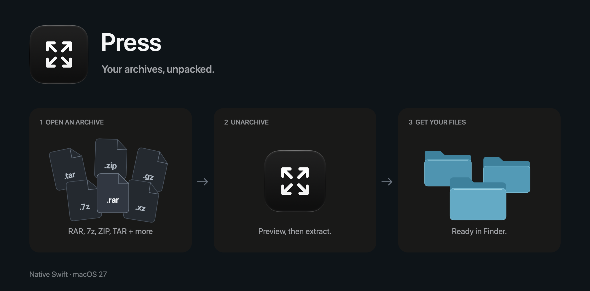

# Press



A small native Swift unarchiver for macOS 27. Open an archive, look inside, and extract its contents where you want them. Supports RAR, 7z, ZIP, TAR, and the other formats read by bundled 7-Zip. No account, activation, or background service. This is a source-only project: build and sign your own copy.

> [!WARNING]
> This application was built entirely with AI. Use it at your own risk.

## Use

- Drop archives into Press, open them with Command-O, or use Finder's Open With → Press. Each preview opens in its own native tab.
- Explore the folder tree before extracting. Select a file and press Space for macOS Quick Look. Only that file is unpacked into a private temporary folder.
- Click Extract and choose a destination. Press creates a folder named after the archive and adds a number if the name already exists.
- Encrypted archives ask for a password when needed. Passwords stay in memory and are not saved.
- Command-T opens a tab, Command-W closes it, and Command-R reloads the preview. Closing a tab cancels its operation and removes its temporary files.

Original archives and existing destination files remain untouched. Press extracts archives; it does not create them. For multipart RAR, open the first `.rar` volume and keep all parts together.

## Settings

In General, choose separate behaviors for opening archives and dropping them into Press: Preview in Press, Extract Beside the Archive, or Choose Where to Extract. Both start with preview.

For example, set Finder opening to Extract Beside the Archive and keep drops set to Preview. Finder extraction runs without opening the main window, asks for a password if needed, and reveals the finished folder in Finder. Press then quits unless you already have a browser or Settings window open.

In File Types, search for a format and click Use Press to make it the default. macOS may ask for confirmation.

## Formats and limits

Supports RAR, ZIP/ZIPX, 7z, TAR, GZIP, BZIP2, XZ, Zstandard, CAB, ISO, DMG, and the other archive and container readers in 7-Zip 26.03. Compressed TAR files show their inner folder tree. Other nested archives appear as files. Specific compression methods depend on the bundled engine.

This is a prototype. Extraction is limited to 10 GB expanded and 10,000 entries per archive. Quick Look is limited to 100 MB per file and 60 seconds. Unsafe paths, symbolic links, and special files are rejected.

The helper runs with network access denied and writes restricted to temporary output. Size checks run during extraction, so limits can be exceeded between checks. They reduce disk exhaustion risk but are not a hard quota or complete protection against malicious archives. See [development notes](docs/DEVELOPMENT.md) for the full limits and sandbox details.

## Build and sign

Requires macOS 27, Xcode 27, Python 3, and OpenSSL available in your shell. Open Xcode once to finish its setup, then run from the cloned repository:

```sh
export DEVELOPER_DIR=/Applications/Xcode.app/Contents/Developer
./scripts/run.sh
```

This builds, signs, installs into `/Applications/Press.app`, and launches it. Use `./scripts/build.sh` to build and sign without installing. The first build downloads the official 7-Zip executable and verifies its pinned checksum; later builds reuse it. The app runs offline.

Signing is automatic. The first build creates your own self-signed development certificate in a private keychain under `~/Library/Application Support/Press/Signing`. Later builds reuse it to sign both the helper and app. Keep that directory private and intact. No paid Apple Developer account or notarization is needed for this local build. The scripts do not change system certificate trust or your default keychain.

## Tests

Run `./scripts/test.sh`. The suite uses real archives and the bundled helper to check previews, passwords, extraction, Quick Look selection, cleanup, and safety limits. It does not install Press or change file associations. See [development notes](docs/DEVELOPMENT.md) for test coverage and the banner generation command.

## License

[MIT](LICENSE). See [third-party notices](THIRD_PARTY_NOTICES.md) for the bundled 7-Zip engine and its license.

## Why can't I just download the binary?

Because I'm not paying Apple $100 a year for this shit. That's what Developer ID signing and notarization would cost, even for a free app. I could ship an unnotarized binary, but you'd still have to deal with macOS security warnings.

Once the build tools above are installed, run `./scripts/run.sh` and you have the app ready. You also get all the source code, so you can see what it does and change whatever you want.
